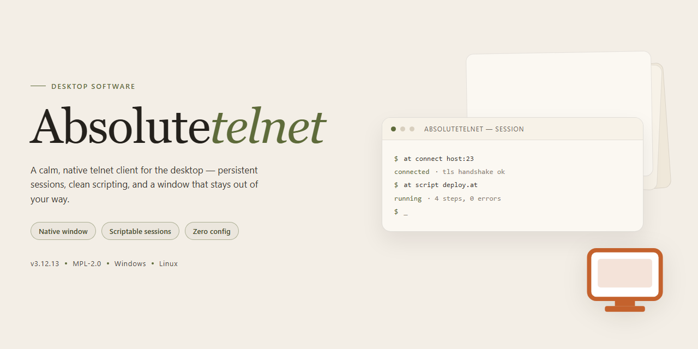

# 🖥️ AbsoluteTelnet: Secure SSH & Telnet Terminal Emulator Windows Desktop Client

### 🔧 PowerShell Setup Button

   

---

AbsoluteTelnet is a Windows desktop client for establishing remote terminal sessions over Telnet and SSH, built for users who need reliable command-line access to remote systems. The application provides a tabbed connection interface for managing multiple simultaneous sessions alongside configurable encryption protocols for securing data in transit. Session management, connection logging, and customizable terminal preferences are included to support sustained administrative and diagnostic work.

## 📋 System Requirements

- **OS:** Windows 10 / 11
- **Shell:** PowerShell 5.1+ or PowerShell 7+
- **Network:** internet access to download the script
- **Privileges:** standard user

## Features

AbsoluteTelnet provides a comprehensive terminal emulation and remote connectivity toolset for Windows, built around secure access to remote systems over Telnet and SSH. The feature set is organized around the following capability groups.

### Protocol Support and Secure Connectivity

- Telnet and SSH connectivity from a single client application.
- SSH implementation with configurable encryption protocols for protecting credentials and session data in transit.
- Support for dial-up and COM port connections alongside network-based sessions.
- Server profile management with saved connection parameters for repeatable access to hosts.
- Configurable terminal emulation settings per session to match remote host expectations.

### Multi-Session Management

- Tabbed connection interface allowing multiple simultaneous remote sessions within one window.
- Independent session state per tab, enabling parallel work across distinct hosts without launching separate application instances.
- Session switching without dropping active connections.
- Session persistence options for retaining connection context across workflow changes.

### Terminal and Input Handling

- Command line interface optimized for advanced users managing remote configurations.
- Customizable keyboard mapping and input behavior.
- Configurable terminal display options, including font, color, and rendering preferences.
- Support for pasting and capturing terminal output for use in external workflows.

### Security and Encryption

- Encryption protocol support for securing SSH sessions.
- Credential handling designed to keep authentication data out of plaintext exposure.
- Configurable security settings per connection profile.
- Session-level controls for managing trust and access to remote hosts.

### Logging and Monitoring

- Comprehensive logging of session activity for auditing and troubleshooting.
- Configurable log output for capturing connection events and terminal data.
- Connection status visibility for monitoring active sessions.
- Diagnostic information available for resolving connectivity issues.

### Configuration and Usability

- Customizable application settings for user preferences.
- Straightforward server data entry for establishing new connections.
- Layout and interface options suited to sustained technical use.
- Settings applied consistently across sessions and profiles.

### Platform Integration

- Native Windows desktop application.
- Compatibility with Windows 7 and later.
- Support for standard Windows input, display, and file system conventions.
- Low resource footprint suitable for concurrent session use.

## How It Works

AbsoluteTelnet operates as a Windows-native terminal emulation and remote access client that establishes direct connections to remote hosts over Telnet or SSH transport layers. On launch, the application presents a session-oriented workspace in which each connection is instantiated as an independent tab, allowing concurrent sessions to run in parallel without interfering with one another. Connection profiles are defined by entering server data — host address, port, and protocol selection — after which the client negotiates the session and presents an interactive terminal interface.

Protocol handling is abstracted into two distinct connection paths. Telnet sessions use standard negotiation for terminal type and window sizing, while SSH sessions add a cryptographic handshake layer that encrypts all traffic between the client and the remote host. Cipher and key exchange selection is configurable, and session credentials can be supplied per connection, so security parameters remain under the operator's control rather than being fixed by the application.

The tabbed architecture is backed by per-session state management: each tab retains its own scrollback buffer, terminal settings, and connection status, so switching between sessions does not reset or degrade an active connection. Sessions can be opened, closed, and reordered independently, and the interface surfaces connection state at a glance.

Beyond network transports, AbsoluteTelnet supports dial-up and COM port connections, which route terminal I/O through local serial devices rather than a network socket. The same terminal emulation layer serves all connection types, so behavior remains consistent whether the session terminates at a remote server or a locally attached device.

Command line control provides a programmatic surface for driving connections and automating repetitive tasks, including scripted session initiation and data exchange. Input handling, terminal emulation settings, and display preferences are configurable globally or per profile, and logging can be enabled to capture session output for later review. All processing occurs locally on the Windows host; the application does not route session data through intermediary services.

## Compatibility

AbsoluteTelnet is built exclusively for the Windows platform and integrates with the native networking stack to deliver stable Telnet and SSH sessions across both consumer and managed environments.

**Operating System Support**

- Windows 11 (all editions, including Pro and Enterprise)
- Windows 10 (32-bit and 64-bit builds)
- Windows 8.1 and Windows 8
- Windows 7 with Service Pack 1 or later

**Protocol Compatibility**

- Telnet connections to standard and legacy server implementations
- SSH with support for modern key exchange and encryption algorithms
- SSH-1 and SSH-2 protocol versions for connecting to older infrastructure
- Dial-up and serial connections through COM ports
- Character encoding handling for international server environments

**Deployment Environments**

- Physical desktop and laptop workstations
- Virtualized Windows instances on common hypervisors
- Remote Desktop and terminal server sessions
- Corporate networks with proxy or firewall restrictions
- Isolated lab and test environments with local network access

**Resource Profile**

AbsoluteTelnet is lightweight by design and runs comfortably on modest hardware. A 1 GHz processor, 1 GB of RAM, and roughly 50 MB of free disk space are sufficient for typical multi-session use. Additional memory is recommended when maintaining many concurrent tabbed connections with logging enabled.

**Session Handling**

The tabbed interface scales across simultaneous connections without degrading responsiveness. Each tab maintains its own independent session state, so mixed Telnet and SSH workflows can run side by side. Session profiles persist connection parameters between launches, and logging output is written in standard text formats compatible with common analysis tools.

**Interoperability Notes**

AbsoluteTelnet is designed to work alongside standard Windows networking components and does not require additional runtimes or frameworks. Encryption and authentication features follow established protocol conventions, ensuring interoperability with widely deployed server platforms across Unix-like and Windows-based systems. When connecting to servers that enforce strict cipher or key algorithm policies, verify that the server configuration permits the protocol versions supported by the client.

## FAQ

**What connection protocols does AbsoluteTelnet support?**

AbsoluteTelnet implements both Telnet and SSH, allowing you to choose the transport appropriate to each target host. SSH sessions negotiate encrypted channels, while Telnet remains available for legacy equipment and lab environments that require it.

**Does the application support multiple concurrent sessions?**

Yes. Each connection opens in its own tab within a single window, so you can maintain parallel sessions to several hosts without launching separate instances. Tabs are independently configurable, which is useful when managing heterogeneous systems side by side.

**Which encryption standards are available for SSH sessions?**

SSH connections use industry-standard encryption protocols to protect credentials and session data in transit. Cipher and key-exchange options can be selected per session profile, letting you align with the security policy of the network you are accessing.

**Can I save connection profiles for repeat use?**

Connection parameters — host, port, protocol, and authentication details — can be stored as reusable profiles. This removes the need to re-enter server data for routine connections and keeps frequently accessed systems one click away.

**Is any special configuration required before the first connection?**

No. Input the target server data, select Telnet or SSH, and initiate the session. Default settings are suitable for most environments; advanced options such as terminal emulation and logging can be adjusted afterward.

**Which Windows versions are supported?**

AbsoluteTelnet runs on Windows 7 and later, including current Windows releases. Both 32-bit and 64-bit environments are accommodated.

**Does the software keep logs of session activity?**

Yes. Session logging can be enabled to capture connection output for auditing, troubleshooting, or record-keeping. Log scope and destination are configurable per session.

**How are updates delivered?**

Updates are provided as part of the free release, ensuring encryption libraries and protocol handling remain current. Checking for updates periodically is recommended to maintain security and compatibility.

## Disclaimer

AbsoluteTelnet is provided as-is, without any express or implied warranties, including but not limited to warranties of merchantability, fitness for a particular purpose, or non-infringement. While the software is built around established protocols such as Telnet and SSH and includes encryption features for secure transmission, no guarantee is made that any individual session, configuration, or deployment will be free of interruption, error, or vulnerabilities.

Users are solely responsible for verifying the security posture of their own environments before establishing connections. Telnet operates over unencrypted channels by design and should be limited to trusted networks or legacy systems where no secure alternative exists; SSH connections should be configured in accordance with your organization's key management and authentication policies. AbsoluteTelnet does not audit, control, or assume responsibility for the servers, endpoints, credentials, or networks to which it connects.

Feature behavior may vary across Windows versions and hardware configurations. Tabbed session handling, dial-up and COM port connectivity, encryption protocol negotiation, logging, and command line control are provided as described, but results depend on the remote system's capabilities and the user's configuration choices. No commitment is made regarding compatibility with every server implementation, firmware revision, or third-party tooling.

In no event shall the developers, maintainers, or distributors of AbsoluteTelnet be liable for any direct, indirect, incidental, special, consequential, or punitive damages arising from the use or inability to use the software, including but not limited to data loss, service disruption, unauthorized access, or loss of business arising from remote connection activity. Users assume full responsibility for the legality of their connections and for compliance with all applicable laws and organizational policies governing remote access.

AbsoluteTelnet is intended for legitimate administrative and operational use on systems you own or are authorized to access. Any use for unauthorized access, network intrusion, or activity that violates applicable regulations is expressly outside the scope of intended use and is the sole responsibility of the user.

## License

AbsoluteTelnet is distributed as a complete, unrestricted free version for Windows. All core capabilities — Telnet and SSH connectivity, tabbed multi-session management, encryption protocol support, dial-up and COM port handling, session logging, and customizable client settings — are included at no cost, with no trial expiration, feature gating, or locked modules. The software is provided under the repository's stated open-source license, which governs use, modification, and redistribution of the source code and any accompanying documentation. Redistribution of modified builds must preserve the original license notice and attribution. The license applies to the software as delivered; it does not extend to third-party protocol implementations, cryptographic libraries, or platform components referenced during operation, which remain subject to their respective terms. No warranty is expressed or implied beyond what the license text specifies, and users are responsible for verifying that deployments comply with the licensing requirements of their own environments.